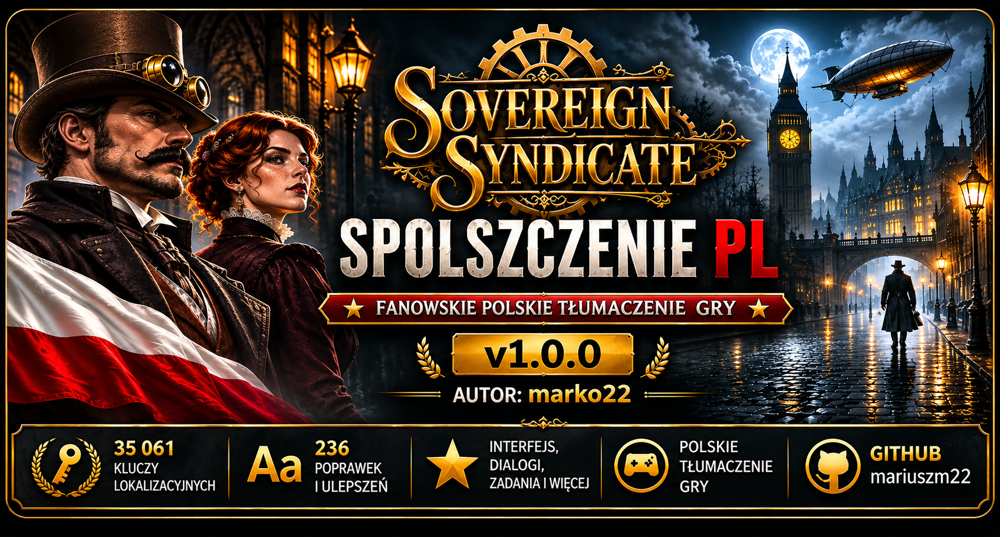
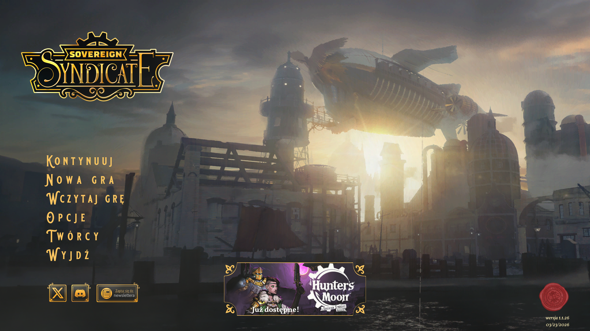
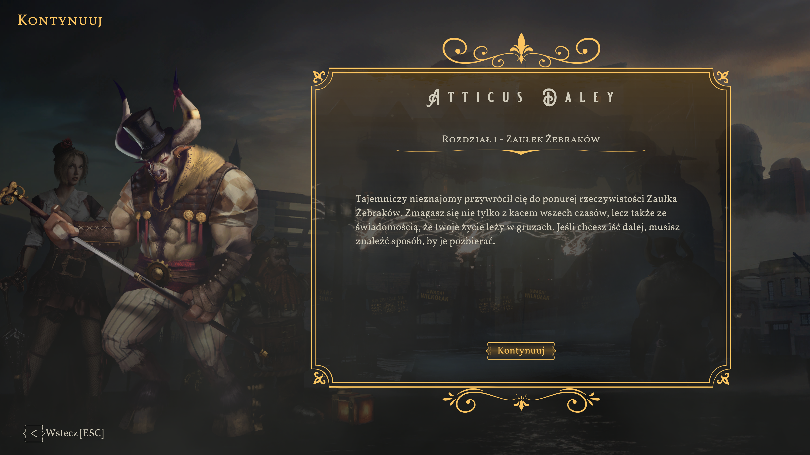
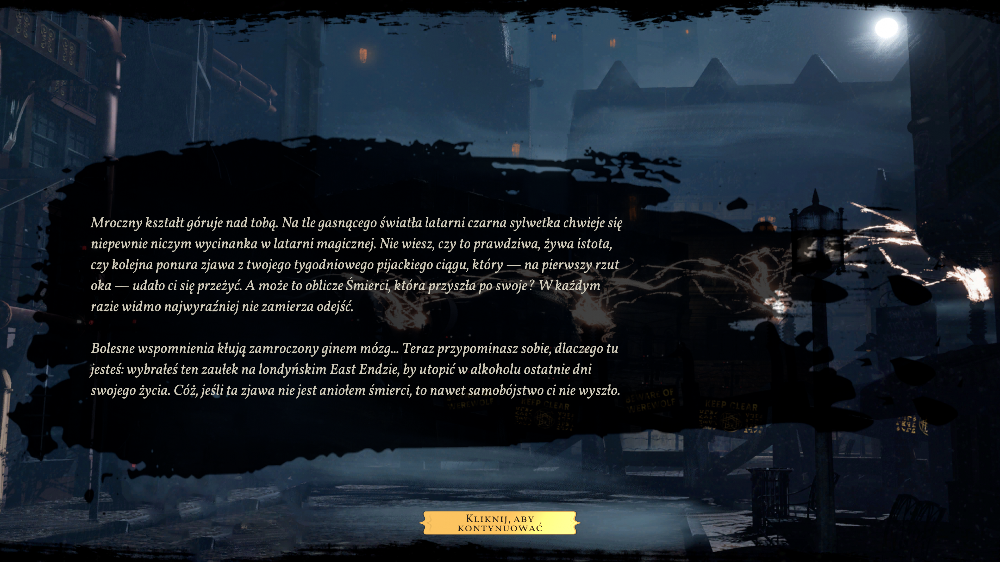
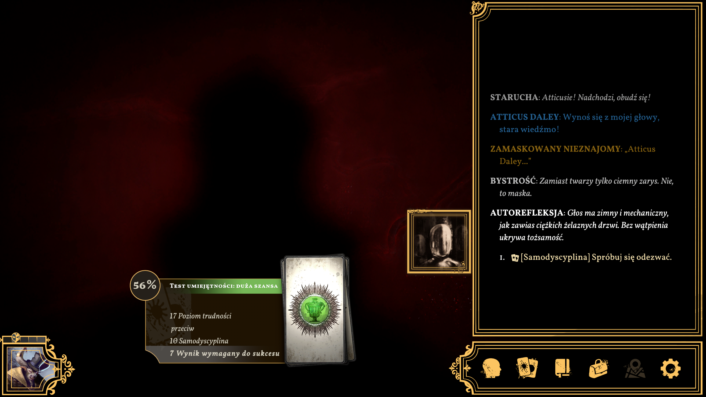
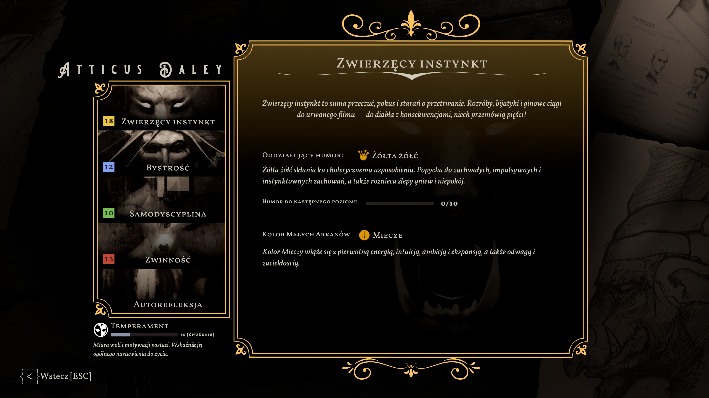
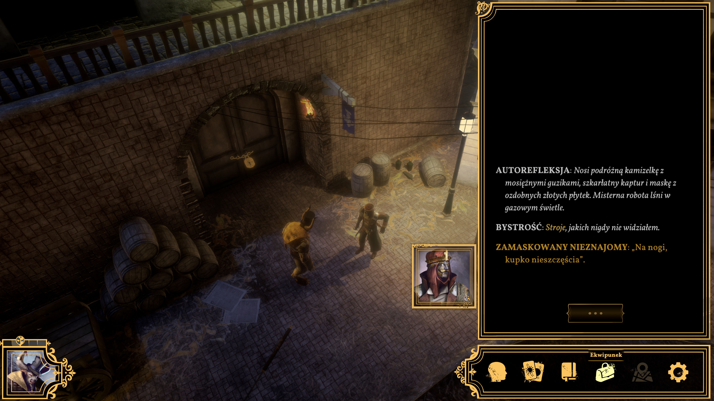

  

# Sovereign Syndicate — Spolszczenie PL

Fanowskie polskie tłumaczenie gry **Sovereign Syndicate**, autorstwa **marko22**.

Wersja: **v1.0.0**

Spolszczenie obejmuje 35 061 rekordów tłumaczenia, w tym dialogi, dziennik, słownik, interfejs i komunikaty gry. Przetłumaczono podpisy wszystkich 78 kart Tarota oraz wybrane szyldy, plakaty, gazety i napisy w menu.

## 📦 Aktualne wydanie

**v1.0.0** · Windows x64 / Steam · gra **1.1.26**, kompilacja **22470327** · AppID **1674920**

Dostępne są dwie paczki:

- **EXE** — automatyczny instalator marko22 (zalecany)
- **ZIP** — instalator EXE i instrukcja w archiwum

➡️ [Pobierz najnowszą wersję](https://github.com/mariuszm22/Sovereign-Syndicate-Spolszczenie-PL/releases/latest)  
➡️ [Pobieranie na marko22.pl](https://marko22.pl/pobieranie#sovereign-syndicate)  
➡️ [Strona projektu i galeria](https://marko22.pl/sovereign-syndicate) · [Kulisy spolszczenia](https://marko22.pl/assets/downloads/sovereign-syndicate/Kulisy_spolszczenia_Sovereign_Syndicate_PL)

## Windows SmartScreen / instalator EXE

Windows może wyświetlić ostrzeżenie SmartScreen, ponieważ instalator EXE nie ma komercyjnego podpisu cyfrowego. Komunikat ten sam w sobie nie oznacza wykrycia wirusa. Sumę SHA-256 pobranego pliku możesz porównać z sumą w [opisie wydania](https://github.com/mariuszm22/Sovereign-Syndicate-Spolszczenie-PL/releases/tag/v1.0.0).

**SmartScreen:** kliknij **„Więcej informacji”**, a następnie **„Uruchom mimo to”**.

---

## 📷 Zrzuty ekranu

  
  

  
  

  
  

---

## 📋 Zawartość tłumaczenia

Spolszczenie obejmuje:

- 35 061 rekordów, w tym dialogi, interfejs, dziennik i słownik,
- polskie podpisy wszystkich 78 kart Tarota,
- wybrane napisy na grafikach i elementach świata gry,
- polskie znaki oraz jednorazowe ustawienie języka polskiego podczas instalacji, gdy pozwalają na to dotychczasowe ustawienia gry.

---

## ⚙️ Instalacja

### 🖥️ Instalator automatyczny — EXE (zalecany)

1. Zamknij grę i pobierz [Sovereign_Syndicate_PL_v1.0.0_Setup.exe](https://github.com/mariuszm22/Sovereign-Syndicate-Spolszczenie-PL/releases/download/v1.0.0/Sovereign_Syndicate_PL_v1.0.0_Setup.exe).
2. Uruchom instalator i potwierdź wykryty katalog gry lub wskaż go ręcznie.
3. Po weryfikacji zgodności wybierz operację i potwierdź ją w kroku 4.
4. Uruchom grę po zakończeniu instalacji.

Przy pierwszej instalacji kreator może ustawić język polski. Jeżeli gra nadal wyświetla tekst w innym języku, wybierz **Polski** w ustawieniach.

### 📦 Instalacja z ZIP

1. Pobierz [Sovereign_Syndicate_PL_v1.0.0.zip](https://github.com/mariuszm22/Sovereign-Syndicate-Spolszczenie-PL/releases/download/v1.0.0/Sovereign_Syndicate_PL_v1.0.0.zip).
2. Rozpakuj archiwum do osobnego katalogu.
3. Przeczytaj `CZYTAJ_NAJPIERW.txt` i uruchom dołączony instalator.
4. Postępuj zgodnie z instrukcjami kreatora.

---

## 🗑️ Deinstalacja

### 🖥️ Spolszczenie zainstalowane przez EXE

Uruchom ponownie ten sam instalator przy zamkniętej grze i wybierz **Przywrócenie plików**. Zachowaj folder kopii zapasowej.

### 📦 Spolszczenie zainstalowane z ZIP

Uruchom instalator rozpakowany z ZIP i wybierz **Przywrócenie plików**.

---

## 🐞 Zgłaszanie błędów

Błędy tłumaczenia można zgłaszać przez [GitHub Issues](https://github.com/mariuszm22/Sovereign-Syndicate-Spolszczenie-PL/issues).

Najlepiej dołączyć:

- zrzut ekranu,
- opis miejsca występowania błędu,
- tekst lub sytuację, której dotyczy problem.

---

## ☕ Dobrowolne wsparcie

Jeżeli chcesz dobrowolnie wesprzeć dalszy rozwój projektów marko22:

➡️ [PayPal](https://paypal.me/mariuszm22)

Wsparcie projektu jest całkowicie dobrowolne.

---

## ⚠️ Informacja

Projekt jest nieoficjalnym fanowskim tłumaczeniem i nie jest powiązany z twórcami ani wydawcą Sovereign Syndicate. Wymagana jest własna zgodna kopia gry. Autor i redakcja: **marko22**.

---

## 🎮 Miłej gry!
